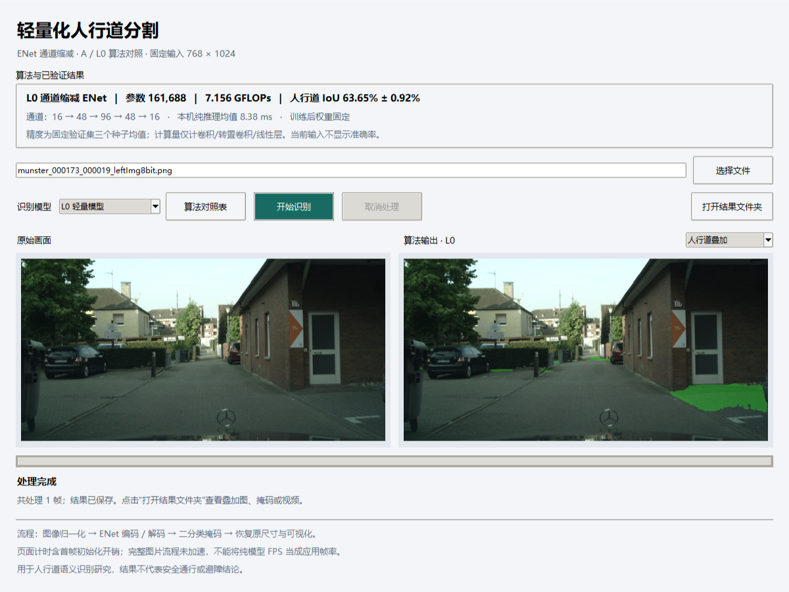
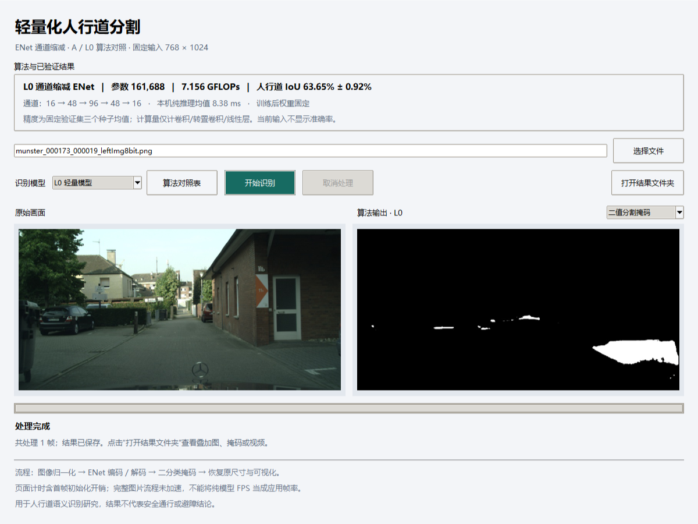
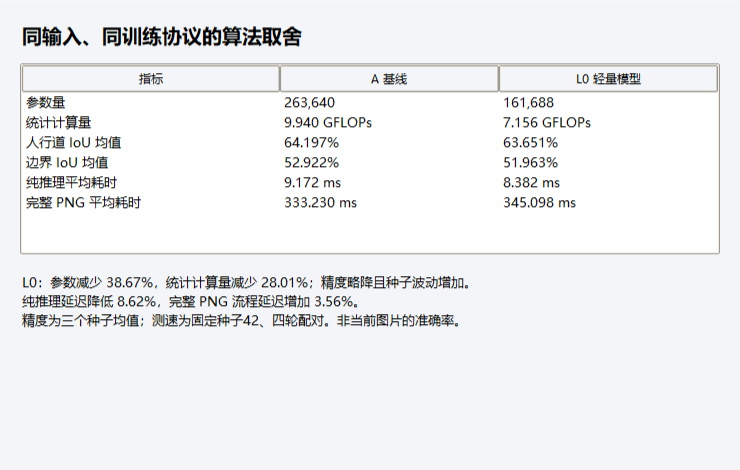
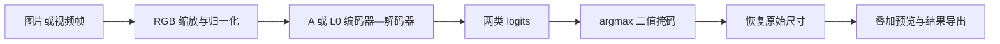
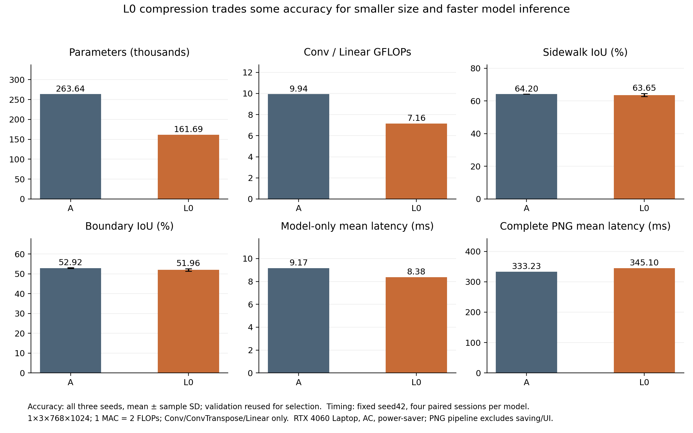

# 轻量化人行道语义分割与算法展示应用

基于 Cityscapes 的人行道二分类研究：对精简 ENet 进行通道缩减，比较注意力机制的实际收益，并将已验证的 A/L0 模型集成到 Windows 桌面软件中。

**L0 相对 A：参数量减少 38.67%，统计计算量减少 28.01%，人行道 IoU 三种子均值下降 0.545 个百分点。** 软件展示算法结构、精度与效率取舍，支持图片和视频识别、叠加预览、二值掩码及结果导出。

[下载源码与模型](https://github.com/coci-hu/sidewalk-segmentation-thesis/archive/refs/heads/main.zip) · [软件使用说明](applications/sidewalk_desktop/README.md) · [最终实验结果](results/compact_final_effect_20261107.json) · [算法实现](experiments/attention_gate/compact_candidate.py)

> 当前为私有仓库，有访问权限的账号才能查看和下载。交付形式为源码与已验证模型，不是独立 EXE 安装包。实际推理需 Windows、Python 和 NVIDIA CUDA 环境；仅看本页截图不需要安装。

## 软件展示

软件默认使用 L0，左侧为输入，右侧为预测的人行道绿色叠加。顶部显示该算法的固定验证结果，**不是当前图片的准确率**。



输出可切换为二值掩码：白色为预测人行道，黑色为背景。原尺寸无损掩码另存为 PNG。



算法对照表集中呈现参数量、计算量、精度和两种计时口径：



截图来自实际运行界面及一张 Cityscapes 验证图，仅将输入栏的本机目录省略为文件名；是功能示例，不代表独立测试集或总体精度。

## 算法与最终结果

A 是本仓库的精简 ENet 基线；L0 保留编码器—解码器和二分类任务，将主要通道宽度从 `16 → 64 → 128 → 64 → 16` 改为 `16 → 48 → 96 → 48 → 16`，不添加注意力。它是通道缩减的任务适配，不宣称新的基础算子。



### 精度与规模

| 模型 | 参数量 | 统计 GFLOPs | 人行道 IoU % | Boundary IoU % |
|---|---:|---:|---:|---:|
| A：精简 ENet | 263,640 | 9.9401 | 64.197 ± 0.024 | 52.922 ± 0.168 |
| B：原宽度 + ReLU CA | 266,992 | 9.9410 | 65.301 ± 0.166 | 53.493 ± 0.165 |
| L0：通道缩减 | **161,688** | **7.1561** | 63.651 ± 0.920 | 51.963 ± 0.675 |

精度为种子 42/43/44 的均值 ± 样本标准差，各训练 100 轮。L0 相对 A 的平均人行道/边界 IoU 分别下降 0.545/0.959 个百分点，种子波动增大，不能声称所有种子下降都不超过 1 个百分点。数据为 Cityscapes 2,975 张训练图、500 张验证图；主口径将 labelId=8 作为前景，其余作为背景。验证集参与权重选择，因此这些数值不是独立测试集性能，也不据三个种子宣称统计显著性。

计算量固定输入 `1 × 3 × 768 × 1024`、FP32、eval，按 `1 MAC = 2 FLOPs` 统计 Conv/ConvTranspose/Linear。**不包含** BN、激活、池化、均值、逐元素运算、插值和 bias 加法，不能当作完整算子 FLOPs。[计数与覆盖](results/lightweight_operator_coverage_20261101_v2.json) · [三种子复评](results/l0_three_seed_review_20261107.json)

### 本机部署效率

| 模型 | 纯推理均值 / P95 ms | 纯推理 FPS | 完整 PNG 均值 / P95 ms | 完整 PNG FPS |
|---|---:|---:|---:|---:|
| A | 9.172 / 9.534 | 108.09 | 333.230 / 386.739 | 2.986 |
| L0 | **8.382 / 8.499** | **118.18** | 345.098 / 365.616 | 2.884 |

L0 的纯推理平均延迟降低 8.62%，但完整 PNG 流程平均延迟增加 3.56%，**没有完整流程加速**。纯模型 FPS 不等于软件、摄像头或视频实时帧率。

平台为 RTX 4060 Laptop 8GB、接通电源、Windows 节能模式。固定种子 42，四轮配对、每模型四个独立会话，每会话预热 50 次、测量 500 次；CPU 一线程。纯推理重复驻留 GPU 张量；完整 PNG 包含解码、预处理、传输、推理、掩码恢复及叠加，不含保存和显示。[完整测速证据](results/compact_benchmark_20261107.json)



### 注意力与负结果

- 原宽度下 B 相对 A 的三种子人行道 IoU 均值提高 1.104 个百分点；C 将 CA 激活改为 h-swish 后，均值低于 B。诊断不支持“注意力普遍失效”或“选择性压制人行道”。[A/B/C 结果](results/abc_summary.json) · [诊断](results/bc_diagnosis_summary.json)
- 固定/可学习混合门控 D/E 未通过预设的双指标筛选条件；L1 仅有单种子探索，不能证明压缩后注意力的稳定收益。[D/E 结果](results/de_seed42_summary.json) · [L1 单种子](results/compact_seed42_audit_20261103.json)
- A/L0 的 FP32 ONNX 各通过 500 图数值与分割指标验收，保留 BN、关闭两类融合和 TF32。尝试过的 FP16 配置未通过预检，不作为已验证功能。[A/L0 导出验收](results/compact_deployment_validation_20261107.json) · [FP16 预检](results/deployment_cuda_fp16.json)

项目成果是轻量化任务适配与取舍分析、注意力受控实验、经数值验证的部署和软件整合。语义人行道识别不等同于安全通行判断；未验证嵌入式实机、路径规划或避障能力。

## 下载与运行

### 1. 获取项目

登录有仓库访问权限的 GitHub 账号，点击 **Code → Download ZIP**，解压整个项目；或：

```powershell
git clone https://github.com/coci-hu/sidewalk-segmentation-thesis.git
cd sidewalk-segmentation-thesis
```

仓库包含桌面应用代码及 A/L0 的 FP32 ONNX、对应训练权重、相对路径模型清单（合计约 3.7 MiB）。无需 Cityscapes 即可识别自己已有的图片或视频；数据集、训练日志、完整断点和个人论文材料不随下载提供。

### 2. 配置环境并启动

在已配置的 Windows CUDA Python 环境中，从项目根目录运行：

```powershell
python applications/sidewalk_desktop/app.py
```

也可双击 `applications/sidewalk_desktop/启动人行道识别.cmd`。启动器支持项目 `.venv`、已激活的 Conda 环境或自定义 `SIDEWALK_PYTHON`。**首次安装请按[详细环境说明](applications/sidewalk_desktop/README.md#环境安装)执行**；已完成本机验收，尚未证明任意新电脑都能直接运行。

### 3. 使用

1. 选择图片或视频，选择 **L0 轻量模型** 或 **A 基线模型**。
2. 查看顶部算法信息，点击“算法对照表”了解两者取舍。
3. 点击“开始识别”，切换“人行道叠加 / 二值分割掩码”查看结果。
4. 点击“打开结果文件夹”获取 PNG、MP4 和结果 JSON。处理视频时可取消；取消输出标为 `.partial.mp4`，不冒充完成结果。

每次输出到新的 `experiments/attention_gate/desktop_outputs/日期时间_任务编号/`；输入文件与旧结果不覆盖。没有标注的用户图片只显示预测和前景占比，不显示虚构的 IoU。[软件验收](results/desktop_application_20261109.json)

## 代码与复核入口

| 目录 / 文件 | 内容 |
|---|---|
| [applications/sidewalk_desktop](applications/sidewalk_desktop) | 桌面界面、推理工作进程、模型、截图、安装使用说明 |
| [compact_candidate.py](experiments/attention_gate/compact_candidate.py) | L0/L1 网络结构 |
| [code/model_enet.py](code/model_enet.py) | A 精简 ENet 基线 |
| [experiments/attention_gate](experiments/attention_gate) | 受控训练、评估、注意力诊断、导出及测速代码和协议 |
| [results](results) | 最终汇总、数值验收、负结果和可追溯证据 |
| [tools](tools) | 结果复核、复杂度统计与冻结验证 |

训练与复评需要自行按 Cityscapes 条款取得数据。历史监督脚本包含本机路径，复现应先检查[统一训练协议](experiments/attention_gate/protocol_v1_2.json)和具体入口参数，并指定新的输出目录。已有 15 组受控 100 轮训练：A/B/C/L0 各三种子，D/E/L1 各一个种子；不将续跑重复计数。仓库还保留历史探索，不能与统一协议结果混排。

原始实验快照分别位于 `19ee2c32a6880fa8067d9555b66bfe91ef0fb638` 和 `39f89ffaaaea77832ec6a5a945e5f2329a2223fa`。新软件与文档不改变这些历史证据；完整 Git 克隆中可运行：

```powershell
python tools/verify_archived_snapshot.py
python tools/verify_compact_archived_snapshot.py
```

`--local` 仅供持有完整本地实验产物时使用；ZIP 下载没有 Git 历史，不能运行这两项历史提交核验。软件功能验收脚本也需要原本地验证素材，普通使用者无需运行研究验收。

## 方法来源

网络采用 ENet 编码器—解码器思路，本仓库为精简实现；CA 参考 [CoordAttention 原作者实现](https://github.com/houqb/CoordAttention/tree/a3f3490ceba779a8443a231d0f792866bd24436d)。第三方实现保留各自来源与许可，Cityscapes 数据需按其条款获取；本仓库不重新分发数据集。
