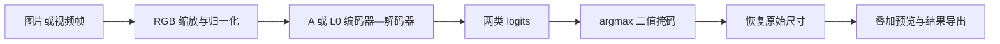

# 轻量化人行道语义分割与算法展示应用

基于 Cityscapes 的人行道二分类研究：对精简 ENet 进行通道缩减，比较注意力机制的实际收益，并将已验证的 A/L0 模型集成到 Windows 桌面软件中。

## 项目目录

下面展示 GitHub 仓库的主要结构；应用目录的逐文件说明见[软件代码导航](applications/sidewalk_desktop/README.md#软件目录与文件职责)。

```text
sidewalk-segmentation-thesis/
├── README.md                         # 项目入口：成果、目录、下载和运行
├── applications/
│   └── sidewalk_desktop/             # Windows NVIDIA GPU 桌面软件
│       ├── app.py                    # 中文界面与任务管理
│       ├── worker.py                 # 图片/视频推理工作进程
│       ├── model_catalog.py          # 算法指标与模型路径管理
│       ├── models/                   # A/L0 ONNX、权重和模型清单
│       ├── screenshots/              # 实际运行界面截图
│       ├── package_entry.py          # EXE 启动与子进程分派
│       ├── gpu_windows.spec          # PyInstaller 打包配置
│       ├── build_gpu.ps1             # GPU 可执行版构建入口
│       ├── prepare_models.py         # 核验并复制模型包
│       ├── verify_app.py             # 桌面功能验收（需本地测试素材）
│       ├── requirements.txt          # 新环境依赖建议
│       ├── 启动人行道识别.cmd          # 源码版 Windows 启动器
│       └── README.md                 # 安装、使用、代码与打包说明
├── code/                             # 基线网络、组件及历史研究脚本
├── experiments/attention_gate/       # 受控训练、轻量化算法、评估与部署模块
├── results/                          # 最终结果、图表和验证证据
├── tools/                            # 复杂度统计、汇总和历史冻结核验
├── archive/                          # 已归档图表及配置，不作为最终主结果
├── code_sam/                         # 历史标注/数据准备工具，不是当前应用依赖
├── run.ps1                           # 历史研究脚本选择器，不是桌面软件启动器
├── .gitignore                        # 排除本地数据、日志和大型构建产物
└── .gitattributes                    # 保持实验文件的原始字节与换行
```

数据集、完整训练日志和大型可执行 ZIP 不包含在上述源码下载中。`models/` 中的两组部署模型是明确随仓库提供的例外。最终证据位于 `results/`；`archive/` 与 `code_sam/` 供历史追溯，不能当作新增数据集或最终实验成果。

**阅读顺序：** 想看效果，查看下方[软件展示](#软件展示)；想运行，查看[下载与运行](#下载与运行)；想读代码，从 `app.py → worker.py → 已验证推理模块` 入手；想看算法，从 [L0 网络结构](experiments/attention_gate/compact_candidate.py)和 [A 基线](code/model_enet.py)入手。

## 开发语言与技术组成

| 部分 | 技术 | 在本项目中的作用 |
|---|---|---|
| 应用逻辑 | Python | 界面事件、模型选择、任务调度和结果保存 |
| 桌面界面 | Python 的 Tkinter/ttk（调用 Tcl/Tk） | 窗口、按钮、进度和图像预览 |
| 算法研究 | Python + PyTorch | 网络定义、训练、评估与导出 |
| 软件推理 | ONNX Runtime GPU + CUDA/cuDNN | 调用已导出模型进行 NVIDIA GPU 计算 |
| 图像与视频 | OpenCV、Pillow、NumPy | 读取、预处理、掩码与叠加图处理 |
| 启动与打包 | PowerShell、CMD、PyInstaller | Windows 启动器及可执行包构建 |

本项目自编应用代码以 Python 为主，没有另外编写 Web 前端或 C++ 应用层。GitHub 的 Languages 使用 Linguist 根据仓库文件识别语言，因此语言栏不是运行时依赖清单，也不表示计算全部由 Python 解释器完成；C/C++/CUDA 等底层实现主要来自第三方库，不算作本项目自行开发的代码。[GitHub 语言统计说明](https://docs.github.com/en/repositories/managing-your-repositorys-settings-and-features/customizing-your-repository/about-repository-languages)

**适用范围：NVIDIA GPU 专用的 Windows 桌面应用。** 面向具有兼容 NVIDIA 显卡、驱动及 CUDA/cuDNN 运行库的使用环境，不提供 CPU、AMD、macOS 或 Linux 版本。不是面向任意电脑的通用软件。已实际验证 RTX 4060 Laptop 8GB；其他型号需单独检查兼容性。

**L0 相对 A：参数量减少 38.67%，统计计算量减少 28.01%，人行道 IoU 三种子均值下降 0.545 个百分点。** 软件展示算法结构、精度与效率取舍，支持图片和视频识别、叠加预览、二值掩码及结果导出。

[下载源码与模型](https://github.com/coci-hu/sidewalk-segmentation-thesis/archive/refs/heads/main.zip) · [软件使用说明](applications/sidewalk_desktop/README.md) · [最终实验结果](results/compact_final_effect_20261107.json) · [算法实现](experiments/attention_gate/compact_candidate.py)

> 当前为私有仓库，有访问权限的账号才能查看和下载。上面的源码下载包含代码与模型，需要配置 Python/CUDA 环境。另有已完成本机验收的 Windows GPU 可执行压缩包；它与源码 ZIP 不同，尚未作为 GitHub Release 附件发布。仅看本页截图不需要安装。

## 软件展示

软件默认使用 L0，左侧为输入，右侧为预测的人行道绿色叠加。顶部显示该算法的固定验证结果，**不是当前图片的准确率**。


输出可切换为二值掩码：白色为预测人行道，黑色为背景。原尺寸无损掩码另存为 PNG。


算法对照表集中呈现参数量、计算量、精度和两种计时口径：


截图来自实际运行界面及一张 Cityscapes 验证图，仅将输入栏的本机目录省略为文件名；是功能示例，不代表独立测试集或总体精度。

## 算法与最终结果

A 是本仓库的精简 ENet 基线；L0 保留编码器—解码器和二分类任务，将主要通道宽度从 `16 → 64 → 128 → 64 → 16` 改为 `16 → 48 → 96 → 48 → 16`，不添加注意力。它是通道缩减的任务适配，不宣称新的基础算子。



### 精度与规模

| 模型 | 参数量 | 统计 GFLOPs | 人行道 IoU % | Boundary IoU % |
|---|---:|---:|---:|---:|
| A：精简 ENet | 263,640 | 9.9401 | 64.197 ± 0.024 | 52.922 ± 0.168 |
| B：原宽度 + ReLU CA | 266,992 | 9.9410 | 65.301 ± 0.166 | 53.493 ± 0.165 |
| L0：通道缩减 | **161,688** | **7.1561** | 63.651 ± 0.920 | 51.963 ± 0.675 |

精度为种子 42/43/44 的均值 ± 样本标准差，各训练 100 轮。L0 相对 A 的平均人行道/边界 IoU 分别下降 0.545/0.959 个百分点，种子波动增大，不能声称所有种子下降都不超过 1 个百分点。数据为 Cityscapes 2,975 张训练图、500 张验证图；主口径将 labelId=8 作为前景，其余作为背景。验证集参与权重选择，因此这些数值不是独立测试集性能，也不据三个种子宣称统计显著性。

计算量固定输入 `1 × 3 × 768 × 1024`、FP32、eval，按 `1 MAC = 2 FLOPs` 统计 Conv/ConvTranspose/Linear。**不包含** BN、激活、池化、均值、逐元素运算、插值和 bias 加法，不能当作完整算子 FLOPs。[计数与覆盖](results/lightweight_operator_coverage_20261101_v2.json) · [三种子复评](results/l0_three_seed_review_20261107.json)

### 本机部署效率

| 模型 | 纯推理均值 / P95 ms | 纯推理 FPS | 完整 PNG 均值 / P95 ms | 完整 PNG FPS |
|---|---:|---:|---:|---:|
| A | 9.172 / 9.534 | 108.09 | 333.230 / 386.739 | 2.986 |
| L0 | **8.382 / 8.499** | **118.18** | 345.098 / 365.616 | 2.884 |

L0 的纯推理平均延迟降低 8.62%，但完整 PNG 流程平均延迟增加 3.56%，**没有完整流程加速**。纯模型 FPS 不等于软件、摄像头或视频实时帧率。

平台为 RTX 4060 Laptop 8GB、接通电源、Windows 节能模式。固定种子 42，四轮配对、每模型四个独立会话，每会话预热 50 次、测量 500 次；CPU 一线程。纯推理重复驻留 GPU 张量；完整 PNG 包含解码、预处理、传输、推理、掩码恢复及叠加，不含保存和显示。[完整测速证据](results/compact_benchmark_20261107.json)


### 注意力与负结果

- 原宽度下 B 相对 A 的三种子人行道 IoU 均值提高 1.104 个百分点；C 将 CA 激活改为 h-swish 后，均值低于 B。诊断不支持“注意力普遍失效”或“选择性压制人行道”。[A/B/C 结果](results/abc_summary.json) · [诊断](results/bc_diagnosis_summary.json)
- 固定/可学习混合门控 D/E 未通过预设的双指标筛选条件；L1 仅有单种子探索，不能证明压缩后注意力的稳定收益。[D/E 结果](results/de_seed42_summary.json) · [L1 单种子](results/compact_seed42_audit_20261103.json)
- A/L0 的 FP32 ONNX 各通过 500 图数值与分割指标验收，保留 BN、关闭两类融合和 TF32。尝试过的 FP16 配置未通过预检，不作为已验证功能。[A/L0 导出验收](results/compact_deployment_validation_20261107.json) · [FP16 预检](results/deployment_cuda_fp16.json)

项目成果是轻量化任务适配与取舍分析、注意力受控实验、经数值验证的部署和软件整合。语义人行道识别不等同于安全通行判断；未验证嵌入式实机、路径规划或避障能力。

## 下载与运行

### Windows GPU 可执行版

可执行交付文件名为 `SidewalkGPU_Windows_x64_20261111.zip`，由维护者单独提供；**当前源码下载按钮不包含这个程序包，也没有已发布的 Release 下载链接**。完整解压后双击 `SidewalkGPU.exe`，保留同目录的 `_internal` 文件夹。包内附带 Python 与推理运行库，目标电脑仍需兼容的 NVIDIA GPU 和驱动；这是免安装压缩包，不是 Setup 安装向导。

已在本机移除测试进程的外部 Python/Conda 搜索路径后，验证窗口、A/L0 CUDA 图像推理与构造视频读写；尚未在另一台干净 Windows 电脑验收。文件大小、SHA-256 与测试范围见[可执行版本证据](results/gpu_package_20261111.json)。[适用环境与详细说明](applications/sidewalk_desktop/README.md#支持范围与论文表述)

### 1. 获取项目

登录有仓库访问权限的 GitHub 账号，点击 **Code → Download ZIP**，解压整个项目；或：

```powershell
git clone https://github.com/coci-hu/sidewalk-segmentation-thesis.git
cd sidewalk-segmentation-thesis
```

仓库包含桌面应用代码及 A/L0 的 FP32 ONNX、对应训练权重、相对路径模型清单（合计约 3.7 MiB）。无需 Cityscapes 即可识别自己已有的图片或视频；数据集、训练日志、完整断点和个人论文材料不随下载提供。

### 2. 配置环境并启动

在已配置的 Windows CUDA Python 环境中，从项目根目录运行：

```powershell
python applications/sidewalk_desktop/app.py
```

也可双击 `applications/sidewalk_desktop/启动人行道识别.cmd`。启动器支持项目 `.venv`、已激活的 Conda 环境或自定义 `SIDEWALK_PYTHON`。**首次安装请按[详细环境说明](applications/sidewalk_desktop/README.md#环境安装)执行**；已完成本机验收，尚未证明任意新电脑都能直接运行。

### 3. 使用

1. 选择图片或视频，选择 **L0 轻量模型** 或 **A 基线模型**。
2. 查看顶部算法信息，点击“算法对照表”了解两者取舍。
3. 点击“开始识别”，切换“人行道叠加 / 二值分割掩码”查看结果。
4. 点击“打开结果文件夹”获取 PNG、MP4 和结果 JSON。处理视频时可取消；取消输出标为 `.partial.mp4`，不冒充完成结果。

每次输出到新的 `experiments/attention_gate/desktop_outputs/日期时间_任务编号/`；输入文件与旧结果不覆盖。没有标注的用户图片只显示预测和前景占比，不显示虚构的 IoU。[软件验收](results/desktop_application_20261109.json)

## 代码与复核入口

| 目录 / 文件 | 内容 |
|---|---|
| [applications/sidewalk_desktop](applications/sidewalk_desktop) | 桌面界面、推理工作进程、模型、截图、安装使用说明 |
| [compact_candidate.py](experiments/attention_gate/compact_candidate.py) | L0/L1 网络结构 |
| [code/model_enet.py](code/model_enet.py) | A 精简 ENet 基线 |
| [experiments/attention_gate](experiments/attention_gate) | 受控训练、评估、注意力诊断、导出及测速代码和协议 |
| [results](results) | 最终汇总、数值验收、负结果和可追溯证据 |
| [tools](tools) | 结果复核、复杂度统计与冻结验证 |

训练与复评需要自行按 Cityscapes 条款取得数据。历史监督脚本包含本机路径，复现应先检查[统一训练协议](experiments/attention_gate/protocol_v1_2.json)和具体入口参数，并指定新的输出目录。已有 15 组受控 100 轮训练：A/B/C/L0 各三种子，D/E/L1 各一个种子；不将续跑重复计数。仓库还保留历史探索，不能与统一协议结果混排。

原始实验快照分别位于 `19ee2c32a6880fa8067d9555b66bfe91ef0fb638` 和 `39f89ffaaaea77832ec6a5a945e5f2329a2223fa`。新软件与文档不改变这些历史证据；完整 Git 克隆中可运行：

```powershell
python tools/verify_archived_snapshot.py
python tools/verify_compact_archived_snapshot.py
```

`--local` 仅供持有完整本地实验产物时使用；ZIP 下载没有 Git 历史，不能运行这两项历史提交核验。软件功能验收脚本也需要原本地验证素材，普通使用者无需运行研究验收。

## 方法来源

网络采用 ENet 编码器—解码器思路，本仓库为精简实现；CA 参考 [CoordAttention 原作者实现](https://github.com/houqb/CoordAttention/tree/a3f3490ceba779a8443a231d0f792866bd24436d)。第三方实现保留各自来源与许可，Cityscapes 数据需按其条款获取；本仓库不重新分发数据集。
