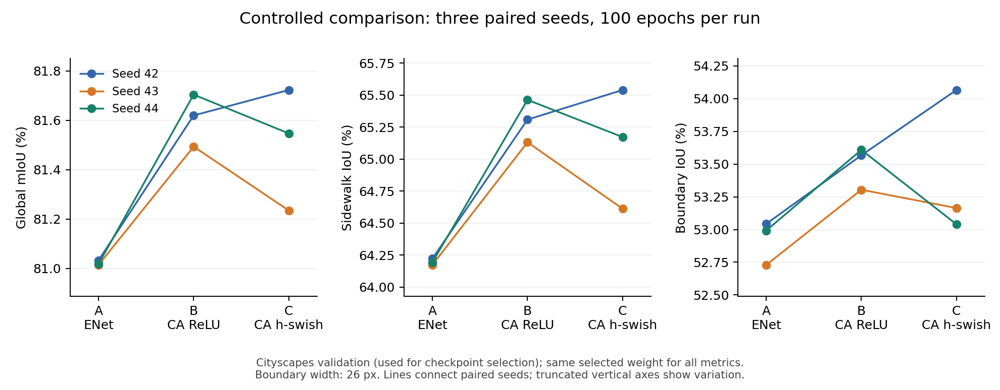
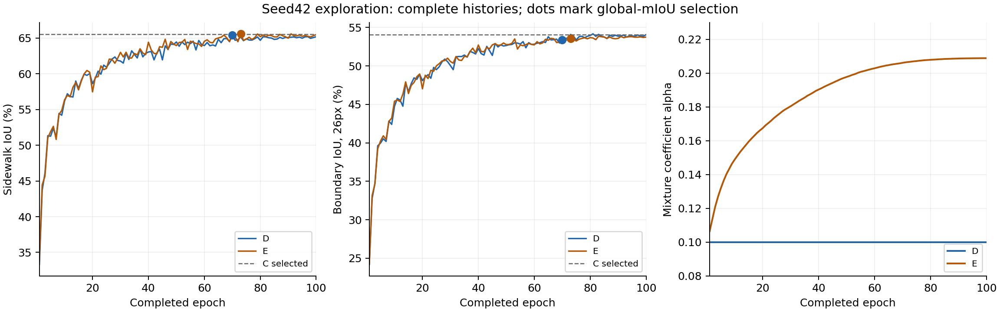

# 基于轻量化语义分割的城市可通行区域识别与边缘部署研究

本科毕业设计，研究 Cityscapes 人行道二分类中轻量网络的注意力行为、受控改进与本机部署。语义人行道预测不等同于安全通行判断，目前不提供路径规划或避障能力。

本仓库同步代码、冻结协议、必要验证凭据和精简结果。数据集、权重、断点、逐轮日志、视频、ONNX 及个人论文材料保留在本地，不随 Git 上传；GitHub 不是这些大文件的备份。

## 当前进度和导师要求

**最新补充：用户转述导师要求增加应用软件，已交付中文Windows桌面版。** 双击本机“桌面/毕设/人行道识别应用”快捷方式，或运行[启动器](applications/sidewalk_desktop/启动人行道识别.cmd)。软件支持图片/视频选择、A/L0切换、原图和结果对照、进度、取消与保存。[使用说明](applications/sidewalk_desktop/README.md)及[功能验收](results/desktop_application_20261107.json)已记录；需要现有本地模型与环境，尚未打包成独立EXE。没有重训或修改已冻结实验。

创新表述按[贡献复核](results/contribution_review_20261107.json)限定为：轻量化任务适配与精度效率分析、注意力的受控研究、验证部署及软件整合。它们是应用改进、实证研究和工程成果，不是三个原创基础算法。D/E未通过筛选，不写成成功创新。参数与同口径计算量下降支持导师已明确提出的要求；学校评分细则未核实，不能保证具体等级。

原算法实验冻结保留在`39f89ffaaaea77832ec6a5a945e5f2329a2223fa`；之后的应用工作以[软件交付计划](experiments/attention_gate/desktop_application_plan_20261107.json)为准。现在旧冻结清单应通过`python tools/verify_compact_archived_snapshot.py --local`核验历史提交与本地证据，不要求新README等同于旧README。

以下保留算法实验阶段的范围与结果，阶段中“软件可选/未开发新GUI”描述的是本次补充前的状态。


2026-11-01按导师新意见重新开启**轻量化补充实验**：核心要求为Params和FLOPs明显下降，嵌入式设备验证不再是必做项，应用软件只作可选整合。**2026-11-07：已批准的训练、复评、导出、本机测速与已有演示整合全部完成，进入论文与答辩整理。**原11次训练、权重、负结果与部署证据均保留，不再安排硬件租用、自采数据或新数据集。

当前唯一执行计划是[轻量化修订计划](experiments/attention_gate/lightweight_revision_plan.json)。导师没有指定比较对象和下降比例；本方案先采用较严格的A（本仓库精简ENet）作直接对照，同时报告相对B的差异。Params及同口径计算量至少下降20%、人行道IoU和Boundary IoU较A下降不超过1个百分点，是项目预先提出的筛选目标，**不是导师指定阈值或已取得结论**。

### L0三种子训练与复评完成

2026-11-07复核：L0种子42/43/44均完成100轮，所选权重各通过500张验证图的独立进程复评；数据、权重及源码哈希未变，汇总混淆矩阵与训练记录一致。完整结果见[三种子复核](results/l0_three_seed_review_20261107.json)，所有种子均保留。

| 模型 | 参数量 | Conv/Linear GFLOPs | 人行道IoU % 均值±样本标准差 | Boundary IoU % 均值±样本标准差 |
|---|---:|---:|---:|---:|
| A 本仓库精简ENet | 263,640 | 9.9401 | 64.197 ± 0.024 | 52.922 ± 0.168 |
| B 原宽度加ReLU CA | 266,992 | 9.9410 | 65.301 ± 0.166 | 53.493 ± 0.165 |
| L0 通道缩减，无CA | 161,688 | 7.1561 | 63.651 ± 0.920 | 51.963 ± 0.675 |

L0较A参数下降38.67%、该口径计算量下降28.01%；三种子平均人行道IoU下降0.545个百分点、边界下降0.959个百分点。平均差异落在先前工作目标范围内，但波动增大，且种子43的人行道IoU下降超过1个百分点，种子44的边界IoU下降超过1个百分点；**不能声称所有种子达标或精度提升**。相对B，L0平均人行道/边界分别下降1.650/1.530个百分点。均值比较是描述性结果，原种子42筛选决定保留，未改为事后按均值重新筛选。

L0三个种子依次选择第88、65、57轮，人行道IoU分别64.709%、63.042%、63.203%。验证集同时用于权重选择和报告，复评不是独立测试集，也不从三个种子宣称统计显著性。

用户已选择“只补L0”。L1只保留种子42：完成100轮，最优第81轮，人行道IoU64.284%、边界52.691%，参数164,208、同口径7.1568GFLOPs；仅作探索，不能作压缩后注意力稳定收益或失效的依据。[种子42完成审计](results/compact_seed42_audit_20261103.json)和[L0种子42复评](results/l0_seed42_reevaluation_20261104.json)保持原样。

输入固定1×3×768×1024、FP32、eval；1 MAC=2 FLOPs，仅统计Conv/ConvTranspose/Linear，不含BN、激活、池化、均值、残差加法、注意力乘法、插值和bias加法。见[复杂度计数](results/lightweight_profile_20261101_v2.json)和[算子覆盖](results/lightweight_operator_coverage_20261101_v2.json)。此计数不等于完整算子FLOPs或实际加速。通道缩减和CA为已有方法，不宣称原创算子。

### 本机部署与测速已完成

[A/L0完整500图验收](results/compact_deployment_validation_20261107.json)已逐图独立重建汇总，原数值与指标阈值通过，实际节点执行CUDA、关闭TF32、保留BN，权重和数据未变。L0的PyTorch/ONNX人行道与边界IoU差异分别约0.0000073/0.0000068个百分点。部署数值口径与训练期TF32设置不同，不能将这些微小变化写成精度提高。

[本次配对测速](results/compact_benchmark_20261107.json)使用预先固定的种子42，四轮交替先后顺序，每模型4个独立会话、共2000帧/流程；每会话预热50次、测500次。原始时延、P95、实际循环FPS、CUDA节点、模型与源码哈希及供电均已独立复核。

| 方案 | 纯推理均值 / P95 ms | 纯推理FPS | 完整PNG均值 / P95 ms | 完整PNG FPS | 专用显存最大观察快照 MiB |
|---|---:|---:|---:|---:|---:|
| A | 9.172 / 9.534 | 108.09 | 333.230 / 386.739 | 2.986 | 448.80 |
| L0 | 8.382 / 8.499 | 118.18 | 345.098 / 365.616 | 2.884 | 318.80 |

L0纯推理平均延迟降低8.62%、实际FPS提高9.33%；**完整PNG平均延迟增加3.56%，没有整套流程加速**，四轮方向一致。显存快照下降约28.97%，不是实际峰值。当前是接电、Windows节能模式、RTX4060 Laptop；纯推理重复同一驻留GPU张量，完整PNG含原图解码、预处理、传输、预测恢复和叠加，不含保存/显示。没有对完整流程变慢作分项因果定位，不追加无界优化或把约118FPS写成摄像头实时能力。

[结果总表](results/compact_final_effect_20261107.json)保留精度、规模、速度及局限；[论文图PNG](results/figures/compact_tradeoff_20261107.png)和[矢量PDF](results/figures/compact_tradeoff_20261107.pdf)可直接复用。

### 轻量化模型演示与冻结

现有图片/视频原型已接入A与L0，默认L0；[验收](results/compact_application_20261107.json)包含实际CLI两张图、32帧视频读写和GPU锁占用拒绝。视频是8张已有验证图各重复4次，不是自然视频、第二数据集或泛化证据。尚无L0长时间稳定性测试，不沿用旧B的30分钟结果冒充L0稳定性。窗口交互沿用原代码，自动验收为headless路径；第一帧时间包含初始化和取证，不作性能指标。未开发新GUI或增加大型软件系统。

```powershell
.\experiments\attention_gate\run_compact_demo.ps1 -InputPath 'D:\已有图片或视频路径' -Headless
```

去掉`-Headless`显示原型窗口，1/2切换A/L0，Q退出；`-Model A`切换启动模型。结果保存在新的`demo_outputs/compact_时间戳`目录，已有结果不覆盖。需要本地模型和已配置环境，Git克隆不含数据与权重。

[第二阶段冻结清单](results/compact_experiment_freeze_20261107.json)记录新增4组完整训练（L0三种子、L1单种子探索），连同历史11组合计15组；续跑不重复计数。旧冻结和负结果保留。现在必做实验剩余0项，不再补种子、租硬件或新增数据集；仅导师明确要求或可复现缺陷才重开实验，另建版本。

后续写作顺序：先整理方法、协议与指标定义（约半天至1天），再写结果及局限（约1至2天），最后按学校模板整理格式、引用和答辩展示（约1至2天）。论文主线是“统一条件纠正历史混杂 → 检验注意力适配 → 通道缩减的精度效率取舍 → 本机部署与应用验证”；不宣称注意力普遍失效、新基础算子或完整系统实时。上述是写作工作量估计，不是新增实验需求。

## 第一阶段历史冻结结果

以下是2026-11-01新要求提出前已完成的实验。[原冻结清单](results/experiment_freeze_20261101.json)及提交`19ee2c32a6880fa8067d9555b66bfe91ef0fb638`保持原样；清单中的“无剩余实验”只对当时范围有效。当前工作树的文档和计划已变化，应使用`tools/verify_archived_snapshot.py --local`按历史提交核验，不能再用原工作树冻结检查要求新文档与旧哈希相同。

截至 2026-11-01，A/B/C 各三个配对种子（42、43、44），共 9 次 100 轮训练已完成且通过完整性核验。以下使用各自最早达到最高验证集 global mIoU 的同一权重，报告均值 ± 样本标准差，单位为百分数。

| 方案 | global mIoU | 人行道 IoU | 人行道 Boundary IoU |
|---|---:|---:|---:|
| A：ENet | 81.022 ± 0.010 | 64.197 ± 0.024 | 52.922 ± 0.168 |
| B：ENet + 现有 ReLU CA | 81.606 ± 0.106 | 65.301 ± 0.166 | 53.493 ± 0.165 |
| C：仅将 CA 激活改为 h-swish | 81.502 ± 0.247 | 65.109 ± 0.467 | 53.423 ± 0.560 |

B 相对 A 在三个种子上均提升；C 相对 B 的平均人行道 IoU 下降 0.193 个百分点，Boundary IoU 下降 0.070 个百分点，种子波动较大。现有结果不支持“CA 普遍失效”或“恢复原论文激活必然提升”。三次种子实验不构成显著性证明；验证集参与模型选择，不能称为独立测试集。

逐种子数值、配对差值与来源见 [results/abc_summary.json](results/abc_summary.json)。历史 15 模型比较存在训练条件差异，只作背景资料，不与此受控表混排。



9 组冻结权重各 500 张的敏感性评价已经完成，并复现原主指标。B 相对 A 在有效标签像素口径和 6、13、26 像素边界下均保留三种子正收益。C 相对 B 的平均 Boundary IoU 差值在 6 像素时为 +0.053 个百分点，13 像素为 -0.006，26 像素为 -0.070；保留原主口径并报告全部宽度。逐城市与前景比例分组见 [敏感性结果](results/sensitivity_summary.json)。

B/C 六组权重在原固定 54 张训练图上各完成 10 种诊断干预。能量匹配后打乱门控仍使表现下降，但人行道特征保留比例没有低于背景；现有证据不支持普遍失效、门控塌缩或选择性压制人行道。推理干预可能改变解码器和 BN 输入分布，不能代替训练对照。见 [诊断结果](results/bc_diagnosis_summary.json)。

D/E 各完成种子 42 的 100 轮探索，并通过完整检查点、配对样本顺序、最终随机状态及历史文件保护核验。D 固定 α=0.1；E 学习 α，最终为 0.208797。以下为同一种子、按验证集 global mIoU 选定同一权重的结果，不能与上面的三种子均值混为一组。

| 方案 | 所选轮次 | global mIoU | 人行道 IoU | Boundary IoU |
|---|---:|---:|---:|---:|
| C：h-swish CA | 83 | 81.723 | 65.540 | 54.066 |
| D：固定混合系数 | 70 | 81.696 | 65.406 | 53.360 |
| E：学习混合系数 | 73 | 81.759 | 65.577 | 53.543 |

E 相对 C 的人行道 IoU 提升 0.037 个百分点，Boundary IoU 下降 0.523 个百分点；D 两项均低于 C。两者都未通过事先声明的“至少一项提高、另一项不下降”条件，因此结束这条探索分支，不补 D/E 的 43、44 种子。E 相对 D 的两项提升仅属单种子观察；不会改用 global mIoU 绕过原筛选条件。完整结果和决定见 [D/E 结果](results/de_seed42_summary.json)及[结果复核](results/de_review.json)。



随后开展 A/B/C 的部署误差与延迟验证；保留 B 是因为它在现有三种子实验中的平均表现最好，工程比较统一使用种子 42。已有 A/B/C 各三张图的 CPU 预检通过，GPU 小样本也通过且实际节点确认为 CUDA。首次各 500 张 GPU 验收出现逐元素数值超限，完整失败记录已保留；标签与区域/边界指标差异均在原范围内。针对失败样本诊断后，保留独立 BatchNormalization 并关闭 ConvBN/ConvActivation 融合，重新完成各 500 张 GPU 验收，全部通过原来的数值与指标阈值。权重、数据和容差均未修改，实际图节点为 CUDA；原图与修正图分别留档。FP16 小样本验证已完成，当前转换配置未通过；已验收 FP32 的 9 个正式测速会话也已完成，结果见下表。

[首次完整验收](results/deployment_cuda_fp32.json)、[数值诊断](results/fp32_numerical_diagnosis.json)和[修正后的完整验收](results/deployment_cuda_fp32_preserved_bn.json)分别记录失败、修正依据与复验结果。保留归一化的配置可能影响速度，后续实测后再作准确率与延迟取舍；不能将组合修改归因为单个优化器缺陷。

FP16 混合精度按[独立预声明协议](experiments/attention_gate/deployment_fp16_protocol.json)完成 A/B/C 各 3 张固定图的 GPU 预检。三组逐元素数值均未达标；A 的人行道 IoU 差异为 0.056 个百分点、Boundary IoU 差异为 0.187 个百分点，超过 0.05 个百分点限值。B/C 的区域与边界差异达标，但仍不能绕过数值检查。按预先规定拒绝这一个转换配置，不运行其全量验收、不追加精度搜索，保留已通过全量验收的 FP32。该观察不代表所有 FP16 方案不可行，也不是 500 图 FP16 指标。完整数值、实际 CUDA 节点和决定见[半精度预检](results/deployment_cuda_fp16.json)。转换未重训、未升级环境，原 FP32 容差和权重未改。

CPU 预检、GPU 并发保护和最新阶段入口见[部署准备结果](results/deployment_readiness.json)。[FP32 测速协议](experiments/attention_gate/benchmark_fp32_protocol.json)已固定为 3 轮轮换模型顺序、每组 50 次预热与 500 帧测量，纯推理和完整 PNG 流程分开统计。预检不作为正式性能结果；显存使用 Windows 进程计数器快照，不声称真实峰值。当前电源条件为接通电源且系统节能模式，将按该条件报告。当前平台为本机 RTX 4060 Laptop；未进行真实嵌入式设备验证；后续已完成的本机稳定性观察见下文。自采数据及人工标注已从本课题剩余范围中取消。

## 实验收尾与本机演示

两周指实验截止窗口，论文写作另有时间。按[收尾范围](experiments/attention_gate/experiment_closeout_plan.json)流程优化分支按原检查规则结束；固定分位数案例和正式 30 分钟稳定性检查均已完成，当时约定范围内的必做实验已完成。此处保留第一阶段历史结论；导师新增的轻量化要求与当前补充训练以文首现行计划为准。

[正式测速](results/deployment_benchmark.json)已独立重算全部原始延迟和实际 CUDA 节点。每个模型 3 个独立会话，每会话各预热 50 次、测量 500 次；下表汇总各 1500 次测量，FPS 按实际循环总时间计算。

| 方案 | 纯推理均值 / P95 (ms) | 纯推理 FPS | 完整 PNG 均值 / P95 (ms) | 完整 PNG FPS |
|---|---:|---:|---:|---:|
| A | 10.34 / 14.11 | 95.78 | 383.54 / 444.39 | 2.59 |
| B | 11.00 / 12.95 | 90.14 | 374.89 / 426.69 | 2.65 |
| C | 10.94 / 12.70 | 90.60 | 382.17 / 433.20 | 2.60 |

纯推理采用驻留 GPU 的固定输入，完整 PNG 包含原始 2048×1024 图片解码、预处理、传输、推理、掩码恢复及叠加，排除保存和界面。接通电源、Windows 节能模式，CPU 一线程；不把约 90 FPS 写成整套系统或摄像头实时帧率。三模型进程专用显存快照最大值均约 448.8 MiB，非真实瞬时峰值。

瓶颈分析后只实现一组 CPU 流程优化：PNG 解码、保持同一 PIL 缩放的精确查表归一化、二分类比较和查表叠加。500 张图的解码像素与输入张量逐位相同，结构化掩码叠加及并列类别处理一致；没有改权重、输入大小、标签或评估标准。按独立的[配对测速协议](experiments/attention_gate/pipeline_comparison_protocol.json)执行时，第一轮 500 图全部一致；第二轮第 207 张预测与叠加哈希不同，提前停止，完成了计划 6 个会话中的 4 个。原流程自身在两轮间也仅该图不同，现有记录不能把差异归因于优化实现；原始哈希不能还原差异像素数量。[失败复核](results/pipeline_comparison_review.json)保留所有部分结果。按原规则不接受此候选、不降低阈值、不续跑第三轮，不发布完整三轮加速结论，默认演示改回原 torchvision、argmax 和 NumPy 叠加流程。

演示沿用已验收的 FP32、关闭 TF32 与两种融合、禁止 CUDA 任务静默回退 CPU，并使用训练同一互斥锁。原优化版的[应用验证](results/application_validation.json)作为历史证据保留。当前原流程入口 sidewalk_demo_reference.py 已重新通过 A/B/C 各一张图片、B 的 32 帧视频读写及 GPU 占用拒绝检查，证据见[原流程演示与案例](results/reference_application.json)。该视频由 8 张现有验证图片各重复 4 次构成，仅检查视频接口，不是自然时序视频、第二数据集或泛化实验。启动后的第一帧含 CUDA 首次执行与取证开销，演示叠字的逐帧时间不是正式性能数据。

本机已配置环境下，从项目根目录启动（默认 B，输出自动使用新目录）：

```powershell
.\experiments\attention_gate\run_demo.ps1 -InputPath 'D:\已有图片或视频路径' -Headless
```

去掉 -Headless 可显示窗口；1/2/3 切换 A/B/C，Q 退出。数据、ONNX 和环境需要本地准备；克隆仓库本身不会下载模型或验证图。

案例按历史 B42 验证结果中有标注人行道的 466 张图排序（另有 34 张标注前景为空），在 0%、10%、25%、50%、75%、100% 秩位置固定选取 6 张，再运行可视化。ID 依次为 94、67、198、359、270、422，IoU 为 0.00%、19.95%、45.98%、68.39%、82.18%、96.62%；六图当前指标与历史值相同。图中包含输入、标注、预测及漏检/误检，图像与掩码保留本地。最差例只有 162 个前景像素，不能将其 0% 推广为总体效果，也不能用最好例代表整个验证集。

[稳定性协议](experiments/attention_gate/stability_protocol.json)固定为同一 B42 会话循环处理 8 张已有图片 1800 秒，记录异常、输出变化与内存快照。[正式稳定性结果](results/deployment_stability.json)已于 2026-10-30 完成并独立复核：1800.057 秒、4476 帧，同图重复预测无变化。进程私有内存结束较开始增加约 14.36 MiB，GPU 专用显存首尾快照均约 364.8 MiB；这些数值是观察结果，不宣称内存完全不增长。该观察不包含自然视频时序精度、长期视频写盘或 GUI 稳定性，也不证明所有输入均无内存泄漏。

## 固定实验条件

[冻结协议 v1.2](experiments/attention_gate/protocol_v1_2.json)：Cityscapes train 2975 张 / val 500 张；输入 768×1024；原始标签 8 为人行道，其余映射背景，忽略区域另做敏感性分析；batch 4、保留尾批；100 轮；AdamW，lr 1e-4、weight decay 0.01；余弦调度；0.4 CE + 0.6 Dice；不使用预训练、增广、AMP 或早停；配对骨干初始化和样本顺序。Boundary IoU 使用 26 像素边界、逐图均值，双方均空时剔除并记录。

已验证环境为 Windows、Python 3.9、PyTorch 2.5.1+cu121、RTX 4060 Laptop 8GB。[环境快照](results/environment.json)记录实际版本，不是已经验证的全新环境安装清单。受控入口含 Windows 锁和防休眠操作，历史恢复需要本地数据、旧检查点和审计档案；不承诺 Linux 上逐位一致。

## 目录与运行

| 路径 | 用途 |
|---|---|
| `code/` | 历史模型、训练、评估、可视化和 Pipeline，保留原接口 |
| `code_sam/` | 历史辅助标注工具，保留但不纳入当前实验收尾 |
| `experiments/attention_gate/` | 受控入口、指标、诊断、部署原型和冻结协议 |
| `results/` | 精简结果、环境及源码哈希 |
| `tools/` | 结果导出与仓库完整性检查 |
| `archive/figures_legacy/` | 原样保留的历史图表，不代表最新受控结果 |

Cityscapes 应按官方许可获取，放入 `dataset/cityscapes/leftImg8bit/{train,val}` 和 `dataset/cityscapes/gtFine/{train,val}`。原本机目录保持不变。

从项目根目录使用配置好的 Python（本机为 `E:\anaconda\envs\blind_road\python.exe`）：

```powershell
# 仅检查哈希、协议和结果一致性，不训练，不需要数据或 CUDA。
python tools/verify_repository.py

# 按历史提交核验第一阶段冻结版本及不变的本地证据。
python tools/verify_archived_snapshot.py --local

# 新复杂度预检必须使用不存在的输出路径，不覆盖已有结果。
python tools/profile_lightweight.py --output results/lightweight_profile_new.json

# 查看受控入口参数。
python experiments/attention_gate/common_runner_v2.py --help
python experiments/attention_gate/common_runner_c.py --help
python experiments/attention_gate/common_runner_mixed.py --help
python experiments/attention_gate/sidewalk_demo_reference.py --help
python experiments/attention_gate/validate_deployment_fp32.py --help
python experiments/attention_gate/export_selected_fp32.py --help
python experiments/attention_gate/validate_deployment_fp32_preserved_bn.py --help
python experiments/attention_gate/convert_selected_fp16.py --help
python experiments/attention_gate/validate_deployment_fp16.py --help
python experiments/attention_gate/benchmark_verified_fp32.py --help

# 旧入口仅列出脚本或显示解析路径。
.\run.ps1 -List
.\run.ps1 -Script eval_main_table.py -DryRun
```

运行需指定新输出目录；恢复拒绝不匹配的数据、协议、源码或完整状态。历史监督脚本含本机路径与审计依赖，仅供追溯；新机器应使用基础训练入口并重新核验。旧训练可能自动恢复断点，旧评估可能覆盖同名输出，应先检查参数。SBNet 对应内部历史名称 `bisenetv2*`，见[命名与标签](code/NAMING_AND_LABELS.md)。本课题不再安排自建数据集；历史辅助工具不构成外部验证证据。

## 来源与记录

CA 参考实现来自 [CoordAttention](https://github.com/houqb/CoordAttention/tree/a3f3490ceba779a8443a231d0f792866bd24436d)，版本与来源保留在 `author_reference/source.json`。混合门控是任务适配候选，不宣称残差门控公式原创。后续保留负结果，同时与 A/B/C 比较。

2026-10-26 的文献更新核实了 [GCNet（CVPR 2025）](https://github.com/gyyang23/GCNet)的官方配置和测速脚本，以及 [TBMSNet（Scientific Reports 2026）](https://www.nature.com/articles/s41598-026-48759-x)的三分支方法与复现条件。当前借鉴部署及边界分析方法，优先完成已冻结的对照实验，不将重型新网络加入必做清单。来源、阅读限制和可行性取舍见 [研究记录](results/research_review_20261026.json)。

个人日志统一写入桌面的《工作记录.docx》。整理前的哈希清单、备份和完整实验输出留在原本机位置。Git 整理不改变冻结实验源码、权重或原结果。
