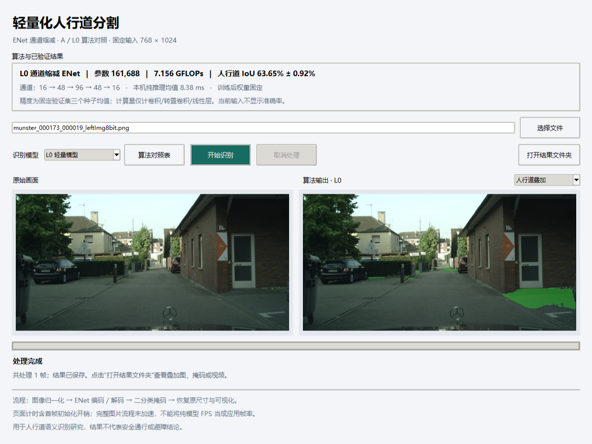
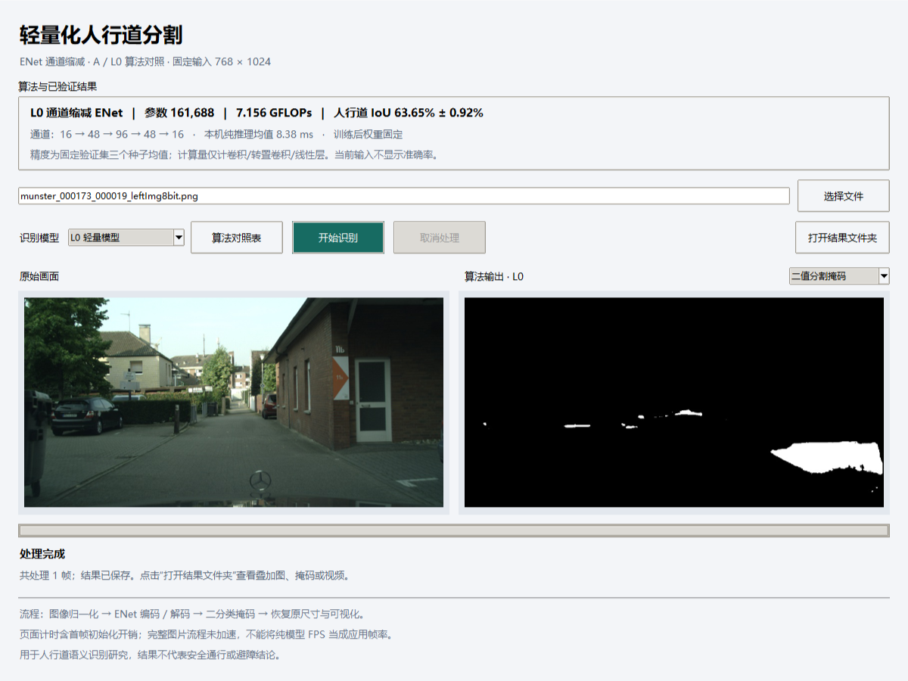

# 轻量化人行道分割桌面应用

Windows / Tkinter 桌面界面，算法为精简 ENet 基线 A 与通道缩减模型 L0；推理使用已验证的 FP32 ONNX Runtime CUDA 路径。界面、模型清单和算法结果读取都相对于项目位置定位，支持移动项目目录。

## 软件目录与文件职责

```text
applications/sidewalk_desktop/
├── app.py
├── worker.py
├── model_catalog.py
├── models/
│   ├── models.json                   # 相对路径、模型身份和 SHA-256
│   ├── A_seed42.onnx                 # A 的 FP32 推理图
│   ├── A_seed42.pth                  # A 原训练权重，用于身份核验
│   ├── L0_seed42.onnx                # L0 的 FP32 推理图
│   └── L0_seed42.pth                 # L0 原训练权重，用于身份核验
├── screenshots/
│   ├── desktop_verified.png         # 原图与人行道叠加
│   ├── desktop_mask.png             # 二值掩码预览
│   └── algorithm_comparison.png     # A/L0 对照表
├── package_entry.py
├── gpu_windows.spec
├── build_gpu.ps1
├── prepare_models.py
├── verify_app.py
├── requirements.txt
├── 启动人行道识别.cmd
└── README.md
```

| 文件 | 职责与使用方式 |
|---|---|
| [app.py](app.py) | 源码版界面入口。处理选择文件、算法切换、预览、开始/取消任务；用 `python applications/sidewalk_desktop/app.py` 启动。推理在独立子进程运行。 |
| [worker.py](worker.py) | 图片/视频解码、调用固定推理流程、导出结果和写进度；通常由界面调用，也支持下方命令行入口。 |
| [model_catalog.py](model_catalog.py) | 从结果 JSON 读取算法指标，将模型相对路径解析为实际路径；由程序导入，不需单独执行。 |
| [models/models.json](models/models.json) | 指定 A/L0 模型文件、种子、所选轮次与哈希；是配置和身份清单，不是训练代码。 |
| [package_entry.py](package_entry.py) | EXE 内部入口，区分窗口启动和 `--worker` 子进程；仅供构建后的程序使用，不直接当 Python 源码入口运行。 |
| [gpu_windows.spec](gpu_windows.spec) | Python 语法的 PyInstaller 配置，定义要收集的依赖、模型、结果文件和科学模块。 |
| [build_gpu.ps1](build_gpu.ps1) | 构建入口；要求新的输出目录，生成完整 `dist/SidewalkGPU/` 文件夹。具体命令见下方。 |
| [prepare_models.py](prepare_models.py) | 维护者工具，先核验模型哈希再复制到新的模型目录；普通用户已随仓库取得模型，无需重跑。 |
| [verify_app.py](verify_app.py) | 实际 GUI、图片/视频、取消、错误及锁冲突验收；依赖原本地 Cityscapes 验证素材，源码下载者不必执行。 |
| [requirements.txt](requirements.txt) | 新环境依赖建议；CUDA 版 PyTorch/torchvision 另按环境安装命令安装，不是全部研究环境的锁定文件。 |
| [启动人行道识别.cmd](启动人行道识别.cmd) | 双击启动源码版，选择 Python 环境并在失败时保留终端错误信息。 |
| [screenshots/](screenshots/) | README 使用的真实界面截图，不参与模型推理。 |

### 软件如何调用算法

界面 `app.py` 启动 `worker.py`，工作进程经 `model_catalog.py` 定位模型，再调用以下位于项目根目录其他位置的模块。因此源码使用时应保留整个仓库的目录结构。

| 共用模块 | 作用 |
|---|---|
| [verified_compact_runtime.py](../../experiments/attention_gate/verified_compact_runtime.py) | 验证模型身份、创建 ORT 会话、GPU 互斥与实际 CUDA 执行取证 |
| [reference_deployment_pipeline.py](../../experiments/attention_gate/reference_deployment_pipeline.py) | 已验证的预处理、argmax 掩码恢复和叠加流程 |
| [deployment_pipeline.py](../../experiments/attention_gate/deployment_pipeline.py) | 当前运行时从中读取固定输入与归一化常量；不代表启用历史候选优化流程 |
| [deployment_equivalence.py](../../experiments/attention_gate/deployment_equivalence.py)、[metrics_v1.py](../../experiments/attention_gate/metrics_v1.py) | 执行提供者证据与评估工具依赖 |
| [results/](../../results/) | 算法展示指标和已通过的模型验收身份；这些静态指标不等于用户输入图片的精度 |

网络结构定义在 [compact_candidate.py](../../experiments/attention_gate/compact_candidate.py)（L0/L1）和 [model_enet.py](../../code/model_enet.py)（A）。桌面推理加载已经导出的 ONNX，不在点击识别时重新训练网络。

### 源码包与可执行包的结构区别

源码包就是上面的仓库结构，使用 Python 入口；可执行包解压后结构如下（运行库文件省略）：

```text
SidewalkGPU/
├── SidewalkGPU.exe                   # 用户双击的入口
├── 使用说明.txt                       # 环境要求与操作提示
└── _internal/                       # PyInstaller 收集的 Python 与原生运行库
    └── project/                    # 保留相对布局的应用、模型和验证文件
        ├── applications/sidewalk_desktop/
        ├── experiments/attention_gate/
        └── results/
```

完整分发 `SidewalkGPU/`，不能只发 EXE。构建目录的 `build/` 是打包中间产物，`dist/SidewalkGPU/` 才是可执行目录；压缩目录形成交付 ZIP 是另一步，`build_gpu.ps1` 本身不生成 ZIP、Setup 安装向导或 GitHub Release。

## 支持范围与论文表述

本软件定位为 **Windows NVIDIA GPU 专用应用**，不要求支持无独显电脑，也不提供 CPU、AMD、macOS 或 Linux 推理版本。适用电脑必须具备兼容的 NVIDIA GPU、驱动和匹配的 CUDA/cuDNN 运行库；仅安装任意版本 CUDA Toolkit 不代表满足依赖。

已验证设备为 RTX 4060 Laptop 8GB，当前打包检查平台为 Windows 11（系统构建 26200）、NVIDIA 驱动 610.62。该驱动是本机观察值，不是经测试确定的最低版本。源码推理使用 PyTorch 2.5.1+cu121、ONNX Runtime GPU 1.19.2（CUDA 12.x / cuDNN 9）。尚未完成其他型号显卡和独立电脑的兼容性矩阵测试。

论文可表述为：“开发面向 Windows 与 NVIDIA CUDA 环境的人行道语义分割桌面应用，集成基线与轻量化模型，实现图像及视频文件输入、预测可视化和结果保存，并在 RTX 4060 Laptop 平台进行功能验证。”不据此宣称跨平台适配、全部 NVIDIA 显卡兼容或嵌入式实机验证。



## 下载内容

从[项目首页](../../README.md)的下载链接或 **Code → Download ZIP** 获取并解压整个仓库。私有仓库要求已登录且获得访问权限。不要只下载本文件夹：程序还使用根目录下的 `results` 和 `experiments/attention_gate` 中的验证结果及运行模块。

`models/` 内有 `A_seed42.onnx`、`L0_seed42.onnx`、对应的两个 `.pth` 和 `models.json`。二者分别使用种子 42 的第 92 / 88 轮已选定权重。清单使用相对路径；运行时核对实际文件 SHA-256 与冻结验收结果。原训练权重一并提供用于身份核验，推理执行 ONNX 图。无需重训或下载 Cityscapes。

源码下载不包含预编译 EXE。维护者另提供 `SidewalkGPU_Windows_x64_20261111.zip`：完整解压到当前用户可写目录后，双击 `SidewalkGPU.exe`，无需另装 Python，不能删除 `_internal`。这是免安装可执行包，不是 Setup 安装向导；没有自动下载器或云端接口。用户图片与视频在本机处理。

程序包附带推理所需运行库，但不附带显卡驱动；仅在上文指定本机完成验收。程序未做代码签名，分发时应附 SHA-256 校验值，不要求用户关闭系统安全防护。可执行版结果保存在 `%LOCALAPPDATA%/SidewalkSegmentation/results`，源码版输出位置见下文。预编译包尚未上传 GitHub Releases，不要将源码 ZIP 当作可执行包。

### 从源码构建 GPU 可执行包

在已配置并核验的 Windows CUDA 环境中，另行安装 PyInstaller 6.16.0（推荐独立工具目录，不改变实验依赖），运行：

```powershell
.\applications\sidewalk_desktop\build_gpu.ps1 -Python '你的环境/python.exe' -OutputDirectory '新的构建输出目录' -PackagingTools '独立打包工具目录'
```

如果 PyInstaller 已在当前构建环境中可用，省略 `-PackagingTools`。输出为 `dist/SidewalkGPU/`，应完整分发该目录。构建过程读取固定模型和科学代码，不重训；主程序会把推理派发给自身的工作进程。验证范围与文件校验值见[打包验收](../../results/gpu_package_20261111.json)。

## 环境安装

**已验证平台：Windows，RTX 4060 Laptop 8GB，Python 3.9.25，PyTorch 2.5.1+cu121，torchvision 0.20.1+cu121，onnxruntime-gpu 1.19.2，NumPy 1.26.4，Pillow 9.3.0，OpenCV 4.12.0。** 使用 Tkinter（Python 安装时需包含 Tcl/Tk）与兼容的 NVIDIA 驱动。当前应用没有 CPU 推理切换功能，缺少 CUDA 时会报错，不会静默回退。

新电脑可在项目根目录按以下方案建立独立环境。这是按官方兼容关系整理的安装方案，**不是已经在全新机器验收的安装器**；不会替换现有研究环境。

```powershell
py -3.9 -m venv .venv
.\.venv\Scripts\python.exe -m pip install --upgrade pip
.\.venv\Scripts\python.exe -m pip install torch==2.5.1 torchvision==0.20.1 --index-url https://download.pytorch.org/whl/cu121
.\.venv\Scripts\python.exe -m pip install -r applications/sidewalk_desktop/requirements.txt
.\.venv\Scripts\python.exe -m pip check
.\.venv\Scripts\python.exe applications/sidewalk_desktop/app.py
```

`requirements.txt` 为新环境选用 OpenCV 4.10.0.84，以适配 NumPy 1.26.4；**这与原本机 OpenCV 4.12.0 不同**，新环境输出应重新验证，不据此声称复现全部论文数值。已验证环境的观察记录见 [environment.json](../../results/environment.json)。

安装依据：[PyTorch 2.5.1 官方历史安装命令](https://pytorch.org/get-started/previous-versions/#v251)；[ONNX Runtime CUDA / cuDNN 兼容表](https://onnxruntime.ai/docs/execution-providers/CUDA-ExecutionProvider.html#requirements)。ORT 1.19 的 PyPI GPU 包使用 CUDA 12.x / cuDNN 9，匹配这里的 PyTorch CUDA 系列。工作进程先导入 PyTorch，再创建 ORT 会话。

已有环境可直接 `python applications/sidewalk_desktop/app.py`。双击启动器时按以下顺序选 Python：自定义 `SIDEWALK_PYTHON` → 项目 `.venv` → 已激活 Conda → 原作者本机环境（若存在）→ PATH 中的 `python`。自定义示例：

```powershell
$env:SIDEWALK_PYTHON = 'C:\你的Python环境\python.exe'
& '.\applications\sidewalk_desktop\启动人行道识别.cmd'
```

启动器不安装依赖；启动失败会保留终端错误信息。仅查看算法界面需要 Python、Tkinter、Pillow 及仓库结果文件，实际识别还需要完整 GPU 依赖。

## 使用方式

1. 点击“选择文件”，打开图片（PNG/JPEG/BMP/WebP）或视频（MP4/AVI/MOV/MKV/M4V，能否解码取决于编码格式）。
2. 选择 A 或 L0，顶部参数量、统计计算量和固定验证精度随之切换；“算法对照表”显示两种模型的精度与速度取舍。
3. 点击“开始识别”。图像按固定 `768 × 1024` 预处理，再将预测恢复为输入尺寸。首帧包含初始化及执行取证，通常较慢。
4. 右侧切换绿色“人行道叠加”或黑白“二值分割掩码”。界面展示的是缩放预览，完整结果另存。
5. 点击“打开结果文件夹”。视频可随时请求取消，当前帧结束后停止；关闭运行中的窗口会提示取消并安全退出。



模型信息为固定实验结果，不是当前画面的精度；没有真实标注时不能计算准确率。当前帧人行道占比也不是置信度或 IoU。纯模型 FPS 不等于包含解码、保存和界面刷新的应用 FPS。

## 保存结果

每次任务独立存入项目中的 `experiments/attention_gate/desktop_outputs/日期时间_任务编号/`。

| 文件 | 含义 |
|---|---|
| `overlay.png` / `mask.png` | 图片原尺寸叠加 / 无损二值掩码（255 人行道、0 背景） |
| `overlay.mp4` | 完整处理的视频；仅保存画面，不保留输入音轨 |
| `overlay.partial.mp4` | 取消或中断的部分视频，不能当作完整输出 |
| `result.json` | 成功结果、模型身份、帧数、耗时和实际执行证据 |
| `status.json` / `error.txt` | 进度、取消状态或出错原因 |
| `runtime_evidence/` | 实际 CUDA 节点执行记录 |

输入文件、旧任务和训练数据不覆盖。预览 JPEG 不是原尺寸无损掩码；视频界面预览按间隔刷新，不逐帧显示。32 帧视频功能验收使用已有验证图拼接片段，只验证读写接口，不是自然视频精度或长期稳定性实验。

## 命令行入口

在完整配置环境中，从项目根目录运行（`--output` 应使用新的目录）：

```powershell
python applications/sidewalk_desktop/worker.py --input "C:\素材\街道.jpg" --output "experiments/attention_gate/desktop_outputs/my_image_001" --model L0
```

`--model A` 运行基线。默认自动读取随仓库提供的 `models/models.json`；也可用 `--models` 指定同一已验证模型的清单。清单与文件身份不符会拒绝执行。`prepare_models.py` 供维护者从原已验收产物复制可移动模型包，普通使用者不需要再次打包。

## 常见问题

| 情况 | 处理 |
|---|---|
| GitHub 显示 404 / 无法下载 | 检查是否使用获得仓库访问权限的账号 |
| 缺少模型 / 哈希不一致 | 重新完整下载项目，勿混用不同模型文件或修改清单哈希 |
| 提示没有 CUDAExecutionProvider 或加载 CUDA DLL 失败 | 检查 NVIDIA 驱动、GPU 版 ORT、PyTorch CUDA / cuDNN 主版本；不要同时混装 CPU 与 GPU 的 ORT 包 |
| 显卡实验锁被占用 | 等其他训练或推理任务退出，勿强行删除正在使用的锁 |
| 视频无法读取或保存 | 尝试常用编码的 MP4；检查该任务的 error.txt，保留原素材 |
| 结果不理想 | 模型针对 Cityscapes 人行道语义训练；陌生城市、夜间或其他分布不保证精度 |

软件仅用于语义分割研究展示，不提供安全通行、避障或导航保证。算法固定验收、GUI 功能测试、路径迁移测试的范围见[本版验证证据](../../results/desktop_application_20261109.json)。
